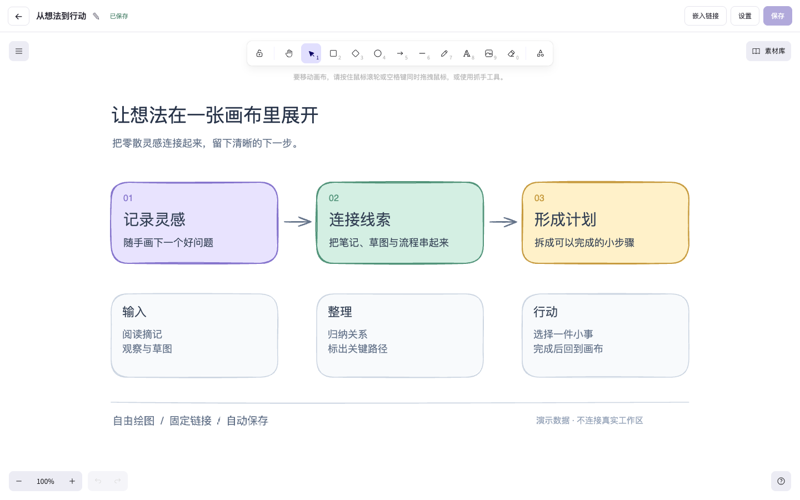
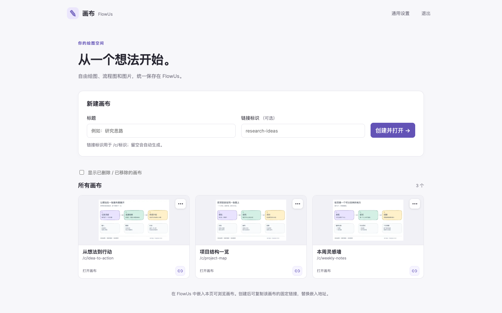
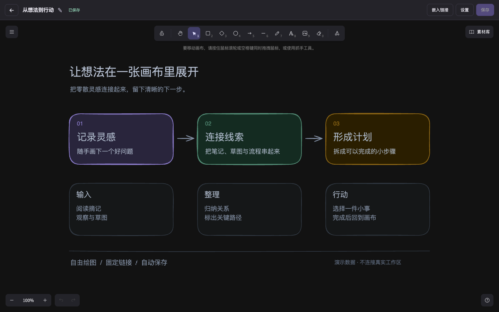
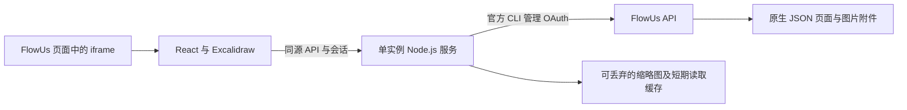
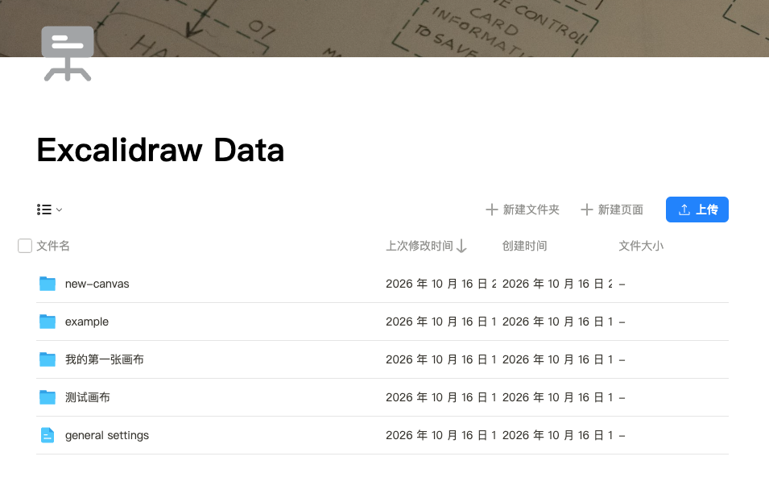

# FlowUs Excalidraw Embedding

将 Excalidraw 画布嵌入 FlowUs 页面。浏览器负责绘图，Node.js 服务负责认证和 FlowUs API 访问，画布 JSON、图片附件、设置及索引均持久保存在你自己的 FlowUs 工作区。



*实际界面，使用完全虚构的演示数据；不连接真实 FlowUs 工作区。*

适合个人或可信小组使用。一个实例使用一个共享访问密码、一个 OAuth 工作区和一个专用数据目录。支持固定链接、自动保存、图片附件、列表预览及画布恢复。

## 界面预览

画布列表：浏览真实场景预览，复制固定链接，再嵌入 FlowUs。本节的列表与深色界面均使用本地演示数据。



深色模式：界面和编辑器跟随系统配色，示例内容保持一致。



可选本机预览：先运行 `npm ci`、`npm run build`，再执行 `npm run demo`。打开终端提示的回环地址，使用固定演示密码 `demo-only-password` 登录。演示仅使用内存 API，不读取 `.env` 或 OAuth 状态，不访问真实 FlowUs；退出进程后演示更改丢失。此模式仅用于本机展示，不应用作生产服务。

## 架构与设计思路



FlowUs 是业务数据唯一持久化来源。服务端持有 OAuth 凭据，浏览器只持有本站会话。这样可统一处理版本检查、上传、重试与附件归属，避免将 FlowUs token 交给嵌入页。

使用一个 FlowUs 文件夹界面统一存储和管理全部画布，每张画布使用独立子文件夹。子文件夹内的 `JSON 数据` 原生页面保存场景，图片作为独立附件与页面同级。普通保存只更新固定 JSON 代码块，已保存图片按 ID 和 SHA-256 引用，减少重复上传。根目录的 `general settings` 页面保存索引、设置和创建任务；上传任务保存在各画布数据页。



*FlowUs 数据根目录示例：每个子文件夹对应一张画布，`general settings` 保存全局设置与索引。此图由项目维护者提供并授权公开，保留原图。*

服务器无需业务数据库。短期读取缓存及缩略图可直接丢弃；删除服务器不会删除 FlowUs 中的内容。恢复服务仍需要重新提供 OAuth 授权、环境配置及登录秘密。

### 为什么这样做

希望在 FlowUs 文档中使用成熟的自由绘图交互，因此复用 Excalidraw 编辑器。图文数据回到同一个工作区，便于组织和迁移；原位 JSON 更新避免每次保存都生成新文件。服务器只缓存派生预览与短期读取结果，减少重复传输，也省去维护第二套业务数据库。

## QuickStart：本机运行

需要 Node.js 24、npm、Git，以及具有目标目录读写权限的 FlowUs OAuth 账号。macOS、Linux 均可本机运行。

### 1. 安装项目与 FlowUs CLI

```bash
git clone https://github.com/DaveBraid/flowus-excalidraw-embedding.git
cd flowus-excalidraw-embedding
npm ci --no-audit --no-fund
```

项目不分发 FlowUs CLI 二进制。使用 [FlowUs 官方安装器](https://cdn2.flowus.cn/flowus-cli/install)，下载后先审阅再执行。以下固定到曾用于本项目的 `v0.3.13`；安装器会选择当前系统和 CPU 架构，并校验官方 `SHA256SUMS`。

```bash
curl -fsSL https://cdn2.flowus.cn/flowus-cli/install -o /tmp/flowus-install.sh
less /tmp/flowus-install.sh
FLOWUS_VERSION=v0.3.13 FLOWUS_INSTALL_DIR="$HOME/.local/bin" bash /tmp/flowus-install.sh
rm /tmp/flowus-install.sh
export PATH="$HOME/.local/bin:$PATH"
flowus version
```

CLI 的发行与可用性由 FlowUs 维护；本项目不要求获取其源码，不授予该二进制的再分发权限。

### 2. 创建独立 OAuth 授权

```bash
mkdir -m 700 oauth-state
export FLOWUS_CONFIG_DIR="$PWD/oauth-state"
flowus login --browser
chmod 700 oauth-state
chmod 600 oauth-state/credentials.json
flowus --json doctor
flowus --json whoami
flowus --json workspace
```

在自己的工作区新建一个**空的真实文件夹**作为专用数据根，取得其 UUID。服务会在其中新建设置页、画布文件夹及附件。OAuth 必须授权该目录。上述身份信息只用于本机配置；凭据文件禁止提交。

### 3. 配置并初始化原生存储

```bash
cp .env.example .env
node -e "console.log('OAuth目录：' + process.cwd() + '/oauth-state')"
command -v flowus
```

编辑 `.env`，填写以下值；路径必须替换成你自己的实际绝对路径。

| 变量 | 含义 |
| --- | --- |
| `FLOWUS_ROOT_ID` | 专用真实文件夹 UUID |
| `FLOWUS_UPLOAD_PAGE_ID` | 与根文件夹 UUID 相同，用作上传权限上下文 |
| `FLOWUS_WORKSPACE_ID` | `whoami` / `workspace` 确认的授权工作区 UUID |
| `FLOWUS_CONFIG_DIR` | 本项目独立 `oauth-state` 目录的绝对路径 |
| `FLOWUS_CLI_PATH` | `command -v flowus` 返回的绝对路径 |
| `PUBLIC_ORIGIN` | 本机先保留 `http://127.0.0.1:3000` |

初始化会读取指定文件夹，并在空目录中新建一个 `general settings` 原生页及两个 JSON 块；不会改写已有同名页。重跑会验证并复用已初始化页面。非空且未初始化的目录会被拒绝。

```bash
node --env-file=.env ops/init-native.mjs
```

将输出的 `FLOWUS_NATIVE_ROOT_ID=...` 填入 `.env` 对应项。此值是 `general settings` 页面 UUID，与根文件夹 UUID 不同。初始化脚本不适用于旧附件格式迁移。

### 4. 创建本站密码并启动

```bash
node ops/create-secrets.mjs
npm test
npm run build
node --env-file=.env server/index.mjs
```

密码输入隐藏，至少 12 字符。脚本只创建密码哈希和独立会话密钥；已有秘密文件会使脚本停止，避免重置现有登录。

访问 [本机画布](http://127.0.0.1:3000)，输入刚设置的密码，创建画布。服务必须从项目根目录启动。`/healthz` 只检查 HTTP 服务存活，无法证明 OAuth 或存储可用；创建、保存并重新加载一张测试画布才完成存储验证。

## 嵌入 FlowUs

先为服务配置自己的域名与 HTTPS，并将 `.env` 中的 `PUBLIC_ORIGIN` 改成浏览器实际访问的来源，例如 `https://draw.example.com`，然后重启服务。反向代理需将 `X-Real-IP` 覆盖为实际客户端地址。

在列表复制画布链接 `https://draw.example.com/c/<slug>`，通过 FlowUs 的嵌入网页功能放入页面。FlowUs 页面访问者仍需通过本站密码登录。浏览器限制第三方 Cookie 时，可使用页面中的“单独打开页面”入口完成登录；iframe 的 Cookie 行为取决于浏览器。

生产部署、Docker 和维护说明见 [README-DEPLOY.md](README-DEPLOY.md)。

## 使用与实现

- 链接标识为 1–80 个小写字母、数字、下划线或短横线，首字符须为字母或数字；改标题保留链接。直接访问不存在的链接先确认创建，GET 不写入 FlowUs。
- 默认停止绘图 2 秒后自动保存；视角、选择和系统主题变化不保存。可关闭自动保存，使用按钮或 Ctrl/Cmd+S。未保存内容仅留在当前页面，应在离开前保存或导出 `.excalidraw`。
- 保存冻结操作 ID、版本和内容快照。结果未知时先查询近期提交凭证，同操作重试复用结果；旧版本返回冲突，保留本地修改。每张画布最多保存近期 32 条提交凭证。
- 图片先记录上传任务，再发送字节及挂载附件。恢复过程验证对象归属与真实哈希；缺图保留引用并提示，避免占位图覆盖原图。
- 列表管理支持删除整个文件夹、仅从列表移除、修复索引与释放已确认删除的标识。FlowUs 回收站恢复文件夹后，可重新修复原链接。
- 附件回收默认宽限 24 小时，至少两次相隔 60 秒的一致扫描；只处理有本应用归属证明的图片和失败任务。引用不完整或读取失败时停止回收。后台每 10 分钟扫描，每批最多 10 次处理。失败任务默认保留 7 天。

在 FlowUs 的 `general settings` 页中，可编辑 `kind: "settings"` JSON 的 `settings` 对象：

```json
{
  "autoSave": true,
  "assetGcEnabled": true,
  "assetGcGraceHours": 24,
  "failedTaskRetentionHours": 168
}
```

保留外层 `schemaVersion`、`kind` 及同页 registry。`assetGcGraceHours` 范围为 0–8760，失败任务保留范围为 1–8760 小时。关闭回收会保留原候选时间；重新开启后，停用时间计入宽限期。

## 边界

- **仅支持单实例运行。** 进程内锁与写前检查无法替代上游原子 CAS。FlowUs 原生代码块更新与删除缺少此保障，外部 UI / 进程同时编辑受管数据仍有竞态；避免同时改写。
- 使用共享密码和单个 OAuth 工作区，无多租户隔离、个人权限系统或实时协同。持有本站密码的用户能访问并管理该实例的全部画布。
- 原生 JSON 每份上限 1 MiB；每张图片 10 MiB，总图 20 MiB，最多 200 张；HTTP 正文上限 32 MiB。这些是应用限制，FlowUs 套餐、API 及上传额度还会单独约束。
- 前台读取缓存最长 10 秒；重新检查和编辑器重新加载可立即回源。服务器缩略图最多 64 张、共 8 MiB；浏览器缓存为有限的临时内存。
- 删除只将 FlowUs 块移入回收站，不承诺释放 OSS 物理空间。历史无归属凭证的孤立对象不会被自动删除。
- 本机 HTTP 用于调试；FlowUs 嵌入需要可访问的 HTTPS 地址。此仓库不提供托管服务。

## 目录与验证

`client/` 为 React 与 Excalidraw；`server/` 包含认证、存储、幂等恢复、保守回收及缓存；`ops/` 提供初始化、审计与迁移工具；`test/` 使用内存 FlowUs API 和故障注入，默认不访问真实工作区。

```bash
npm test
npm run build
```

前三张应用截图使用虚构演示数据；FlowUs 目录示例图由项目维护者提供并授权公开，保留原图。仓库不包含 OAuth 状态、私有部署配置或供应商二进制。

本项目以 [MIT 许可证](LICENSE)发布。Excalidraw、React、Vite、图标、字体及其他第三方依赖仍适用各自的许可证；使用与再分发时请同时保留其要求的许可证和 notices。
